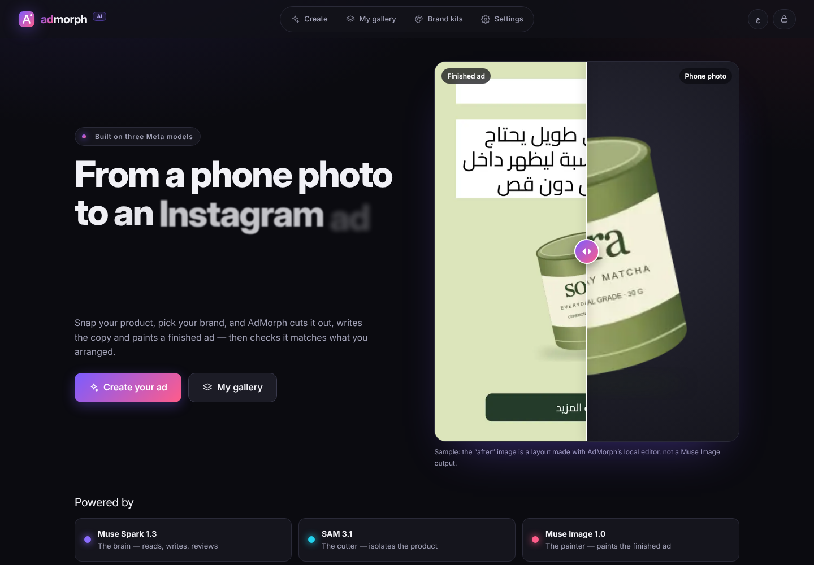
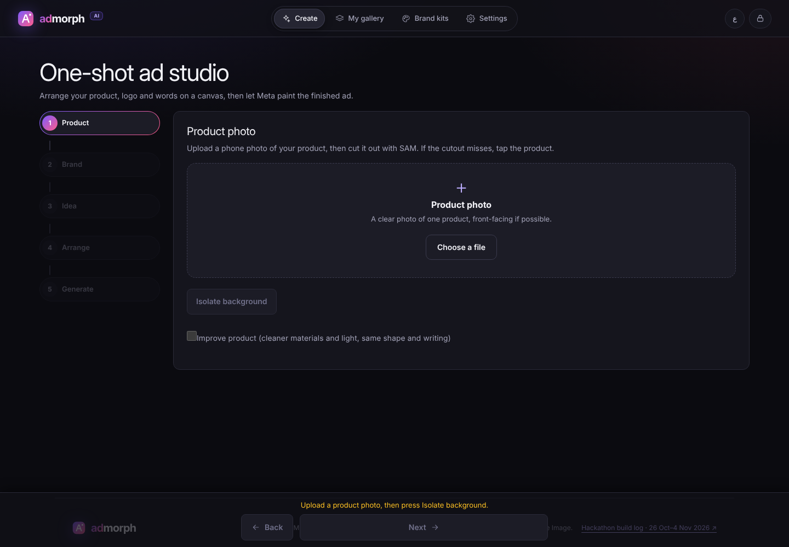
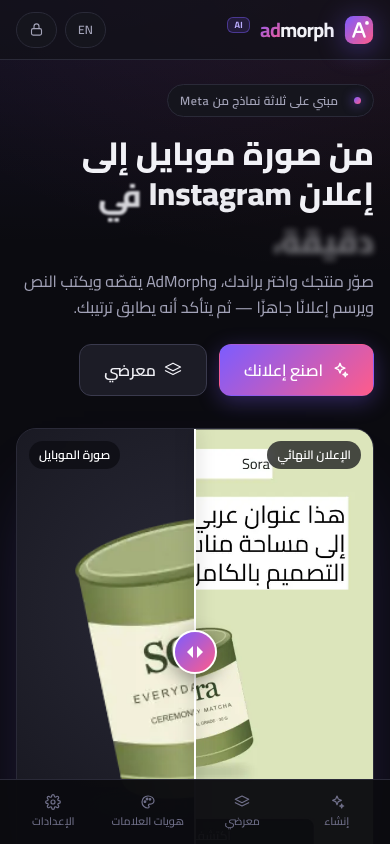
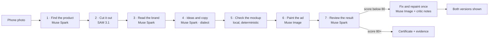

# AdMorph AI

**From a phone photo to an Instagram ad in a minute, in your dialect.**

A small shop owner has one phone photo of a product, or one photo of a whole shelf. AdMorph cuts the product out, reads the brand, writes the copy in their dialect, lets them arrange the ad at the size they need, paints the finished image and then checks that it matches what they arranged. It runs only on Meta models, in English and Arabic (RTL), on phones and desktops.

Built for the Meta Global AI Developer Hackathon (26 Oct – 4 Nov 2026). Live site: <https://admorph-ai-app.vercel.app/> · Demo video: _to be added before submission_.

| Home | Wizard | Arabic on a phone |
| --- | --- | --- |
|  |  |  |

## Three Meta models, fixed jobs

Nobody picks models. Each one has one job, and every step on screen names the model doing it.

| Model | ID | Job | Routes |
| --- | --- | --- | --- |
| Muse Spark 1.3 — the brain | `muse-spark-1.3-contributor` | Understands the product photo, finds the product box, finds every product and price tag on a shelf, extracts the brand, writes ideas with an art-direction brief and copy in the chosen dialect, reviews the finished ad | `product-box`, `shelf-detect`, `brand-extract`, `plan`, `shelf-plan`, `shift-copy`, `verify-oneshot`, `critic`, `check-background` |
| SAM 3.1 — the cutter | `sam-3.1` | Cuts the product out of its photo (or each product out of a shelf), guided by Muse Spark's box or the user's tap | `segment` |
| Muse Image 1.0 — the painter | `muse-image-1.0` | Paints the finished ad from the mockup, enhances phone photos, makes variants and seasonal versions | `oneshot`, `product-makeover`, `ad-remix` |

The IDs live in one place: [`src/lib/ai/models.ts`](src/lib/ai/models.ts).

## The agent pipeline



On screen each step is a card with its model badge, live timer, real duration, a one-line result, a retry on failure and **Show details** (the redacted request and the structured response). When the critic scores the first ad below 80, its failed checks become concrete notes and go back to Muse Image for exactly one more attempt; both versions stay visible with their scores.

## The user journey

A five-step wizard, one decision per screen, with Back/Next always in reach and progress saved in IndexedDB:

1. **Product** — upload a phone photo; SAM cuts it out (glowing-edge reveal); tap the product if the cutout misses; optional enhance.
2. **Brand** — a saved brand kit, or a name and description; Muse Spark can extract it from the photo. The logo slot lives here, with a one-tap **transparent background** for a logo on a flat color (done on the device, no request).
3. **Idea** — pick the dialect (Egyptian, Gulf, Levantine, Sudanese, Standard Arabic, English) and get three ideas. Each idea carries an **art-direction brief** (place, props, light, camera, composition, palette, headline style, what to avoid) that becomes the scene, and the last five places are remembered so every round lands somewhere new. Pick a headline font from 23 curated Latin and Arabic families, each previewed in its own face.
4. **Arrange** — pick the **ad size first** (4:5 feed, 1:1 square, 9:16 story); the mockup, the request and the result all use it. Drag the product, logo and words; add price, discount and button **badges** or your own icon, style each text (color, size, bold, alignment, font), reorder or delete in the **layers** panel, and let elements **snap** to the frame and to each other. A deterministic check flags overlaps, contrast and safe margins, each with a one-click fix and undo.
5. **Generate** — the agent runs, the ad fades in, the certificate ring fills and its checks tick in; download the PNG or the evidence ZIP, open **Why trust this ad?**, or make variants and seasonal copies.

Finished ads land in **My gallery** on the device. Any saved ad can become **variants** (each one changes a different thing: the place, the light and angle, or the palette and mood) or a **seasonal copy** for Ramadan, Eid, Black Friday or Summer, painted fresh from the product cutout with that season's palette and props.

## Shoot the shelf, get a campaign

`/shelf` turns one photo, or a short video, of a shop shelf into a campaign:

1. **Capture** — a photo or a video of up to 20 seconds from the phone camera; for a video the sharpest frame is picked on the device. A sample shelf runs the whole flow in one click.
2. **Find** — Muse Spark finds up to six products and reads each price tag; numbered boxes appear on the photo.
3. **Cut, live** — SAM cuts each product from its box on screen, and each cutout flies from the shelf into its own card.
4. **Check** — edit names and prices, switch products off, pick a brand and dialect; the screen shows how many requests the campaign will make.
5. **Campaign** — one planner call names the campaign and writes a headline, button text, scene and caption per product; Muse Image paints one ad per product, the critic reviews each one, and a weak ad gets one repair. Download each ad, share it, or take the whole campaign as a ZIP.

## Guided demo

"Watch the full demo" on the home page walks the whole site with live Meta requests: a bundled phone photo of headphones becomes a finished ad (SAM 3.1 cut, Mono Audio brand, Muse Spark ideas, Muse Image paint, critic review and one repair), that ad gets a Ramadan version on the seasons page, and the bundled shelf photo becomes one ad for each of its first two products.

- **Auto** plays every step by itself, each kept on screen long enough to read (good for recording). **Step** waits for Next before each step (good for judges). The mode can be switched mid-run, Auto can be paused, and Exit stops it.
- A sticky bar under the header names the step, the Meta models it uses and the seconds it is taking. A failed step stops with Retry and Skip; nothing is faked or replayed.
- The run lives in `sessionStorage` (step, timings and the new ad's id, no images), so it survives a page change or reload. Steps are defined in `src/lib/demo/tour.ts`; each page drives its own steps through `useDemoDriver`.
- One run makes about 20–30 Meta requests and takes 4–7 minutes. Replace `public/demo/demo-product.webp` or `public/demo/shelf-sample.jpg` to demo other products.

## Trust and evidence

- **Fidelity certificate** — Muse Spark compares the finished ad with the mockup (product, logo, layout, each text) and lists any **extra words** the painter invented, such as a made-up brand name or slogan; each one costs points and goes back to the painter as a fix. Seasonal copies must show at least two of their season's props or they are painted again. The score is labelled as a model judgment.
- **Why trust this ad?** — the exact model IDs, SHA-256 fingerprints of the original photo, the product used and the finished ad, and the deterministic layout checks, all computed on the device.
- **Evidence ZIP** — the PNG plus a manifest with those hashes, checks, model IDs and the certificate.

## Cutout quality

A Muse Spark box is often drawn tight, and SAM never cuts past the box it is given. Every box is therefore grown by 5% of its size first; if the cut still runs into a box edge, it is retried once with a 20% margin, and the first cut is kept if the retry fails.

## Run it

Requires Node.js 24.x.

```bash
npm ci
npm run dev -- --hostname 127.0.0.1     # http://localhost:3000
```

The site uses its own Meta key, set on the server as the environment variable **`META_API_KEY`** (on Vercel: Project → Settings → Environment Variables, then redeploy). Visitors never enter a key, and the key never reaches the browser: AI routes add it server-side, and the browser only learns that one is configured (`/api/site-config`). Never name it with a `NEXT_PUBLIC_` prefix. For local runs, put it in `.env.local` (see `.env.example`). Every model request still comes from an explicit user action.

## Checks

```bash
npm run lint
npm run typecheck
npm test                      # unit (Vitest)
npm run build
CI=1 npm run test:e2e         # Playwright against next start: 1440px, 375px touch, 320px
```

The E2E suite intercepts every Meta route, so it never makes a paid call. A screen-matrix spec loads every main page at 360, 390, 768, 1280 and 1440px in English and Arabic and fails on any horizontal overflow.

## Security and storage

- Brands, logos, saved ads and the wizard draft live in IndexedDB on this browser (Blobs, never base64 in localStorage). Nothing syncs to a server.
- AI routes accept same-origin JSON only, validate every request and response with strict Zod schemas, call fixed Meta hosts, and apply per-instance best-effort rate limits per hashed key.
- The Meta key lives only in the server environment (`META_API_KEY`); it is never sent to, shown in or stored by the browser. With it set, the per-key request budget is off, so usage is limited only by the Meta account.

## History and honesty notes

- A first baseline was uploaded on the afternoon of 26 October, before the evening kickoff; everything after it was built during the hackathon. See [HACKATHON.md](HACKATHON.md) and [BUILD_LOG.md](BUILD_LOG.md).
- Earlier milestone and release reports, and the previous README, are in [docs/archive](docs/archive/).
- The home page showcase holds real ads made on the live site with Muse Image from single product photos (listed in [`public/showcase/showcase.json`](public/showcase/showcase.json)), each with its certificate score. To change the before/after comparison at the top of the home page, upload the two images to `public/showcase/` and point `hero.before` / `hero.after` in `public/showcase/showcase.json` at their exact file names (allowed: `.webp`, `.png`, `.jpg`; the hero now uses `headphones-photo.webp` and `headphones-ad.webp`). Set `hero.ratio` to `"1:1"` for square images or `"4:5"` for portrait ones. Do not delete an image that `showcase.json` still lists, or the page shows an empty frame.
- Every feature was run against live Meta models on the production site on 30 October (see [BUILD_LOG.md](BUILD_LOG.md)); the bugs that run found are fixed.

The source uses the [MIT license](LICENSE); fonts and packages keep their [third-party notices](THIRD_PARTY_NOTICES.md).
